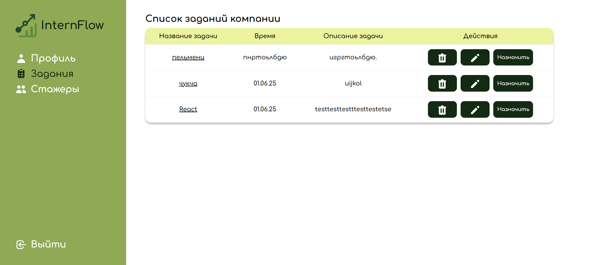

# 🎓 InternFlow — Internship Learning Platform

**InternFlow** — веб-платформа, предназначенная для организации и автоматизации процесса обучения стажёров внутри компании.

Проект представляет собой образовательную систему, которая помогает организовать процесс стажировки, предоставить стажёрам доступ к учебным материалам и отслеживать их прогресс в процессе обучения.

Платформа ориентирована на создание удобной цифровой среды для взаимодействия стажёров и компании, структурирования учебного процесса и контроля результатов обучения.

Frontend-приложение разработано с использованием React 19, Zustand и React Router DOM. Для имитации Backend и хранения данных во время разработки используется JSON Server.

**InternFlow — дополнительный дипломный проект, разработанный для решения задач обучения и сопровождения стажёров компании.**

---

## 📸 Screenshots



---

## ✨ Features

- 🎓 **Internship Learning Platform** — цифровая среда для обучения стажёров компании.
- 📚 **Learning Materials** — организация и отображение учебных материалов.
- 📊 **Progress Tracking** — отслеживание прогресса обучения.
- 👤 **User Authentication** — регистрация и авторизация пользователей.
- 🔐 **OTP Verification** — интерфейс подтверждения пользователя с помощью одноразового кода.
- 📝 **Form Validation** — проверка пользовательских данных с использованием Formik и Yup.
- 📈 **Data Visualization** — визуализация учебных показателей и результатов с помощью Recharts.
- 🔄 **State Management** — управление состоянием приложения через Zustand.
- 🧭 **Navigation** — маршрутизация между страницами с помощью React Router DOM.
- 🔗 **API Integration** — взаимодействие с серверной частью через Axios.
- 🖥️ **Mock Backend** — использование JSON Server для имитации REST API.
- ✨ **Interactive UI** — интерактивные элементы и анимации интерфейса.

---

## 🛠 Tech Stack

| Technology | Purpose |
|---|---|
| React 19 | Разработка пользовательского интерфейса |
| JavaScript (ES6+) | Клиентская логика приложения |
| Zustand | Управление глобальным состоянием |
| React Router DOM 7 | Маршрутизация и навигация |
| Axios | HTTP-запросы и взаимодействие с API |
| Formik | Управление пользовательскими формами |
| Yup | Валидация данных |
| JSON Server | Имитация Backend API |
| Recharts | Визуализация данных и статистики |
| React Spring | Анимация интерфейса |
| React OTP Input | Ввод одноразовых кодов подтверждения |
| CSS / SCSS | Стилизация пользовательского интерфейса |
| npm | Управление зависимостями |

---

## 🏗 Architecture & Development

Приложение построено на основе компонентной архитектуры React с использованием Zustand для управления состоянием.

Основные архитектурные решения:

- **Component-Based Architecture** — разделение приложения на независимые и переиспользуемые компоненты.
- **Zustand** — централизованное управление состоянием приложения.
- **React Router DOM** — организация маршрутизации и навигации между страницами.
- **Axios** — выполнение HTTP-запросов и взаимодействие с API.
- **Formik & Yup** — управление формами и валидация пользовательских данных.
- **JSON Server** — создание локального REST API для имитации серверной части.
- **Recharts** — построение графиков и визуализация данных.
- **React Spring** — создание плавных анимаций и интерактивных переходов.

---

## 🧠 What I Learned

В процессе разработки проекта я получил практический опыт:

- Создания образовательных веб-платформ на React.
- Построения компонентной архитектуры приложения.
- Использования Zustand для управления глобальным состоянием.
- Настройки маршрутизации с React Router DOM.
- Интеграции Frontend с REST API через Axios.
- Создания и настройки локального Backend с помощью JSON Server.
- Разработки и валидации пользовательских форм.
- Работы с Recharts для визуализации статистики и результатов обучения.
- Использования React Spring для анимации интерфейса.
- Организации структуры сложного React-приложения.
- Разработки пользовательского интерфейса для образовательных процессов.

---

## 💻 Installation & Setup

Для локального запуска проекта необходимо установить зависимости и запустить Frontend и JSON Server.

### 1. Clone the repository

```bash
git clone <REPOSITORY_URL>
```

### 2. Navigate to the project directory

```bash
cd internFlow
```

### 3. Install dependencies

```bash
npm install
```

### 4. Start the Frontend

Откройте первый терминал и выполните:

```bash
npm run dev
```

Frontend-приложение будет доступно по адресу:

[http://localhost:5173](http://localhost:5173)

### 5. Start JSON Server

Откройте второй терминал в директории проекта:

```bash
npm run server
```

JSON Server запустит локальный API. Порт и адрес сервера определяются настройками скрипта в `package.json`.

**Important:** Для корректной работы приложения необходимо одновременно запустить Frontend и JSON Server.

---

## 🎓 Additional Graduation Project

**InternFlow** — дополнительный дипломный проект, направленный на цифровизацию процесса обучения стажёров внутри компании.

Проект демонстрирует применение современных Frontend-технологий для создания образовательной платформы, организации учебного процесса и визуализации результатов обучения.

---

## 👨‍💻 About the Project

**Developer:** Дастан Алмазбеков

**Role:** Frontend Developer

**Project Name:** InternFlow

**Project Type:** Internship Learning Platform

**Project Status:** Additional Graduation Project

**Main Focus:** React 19, Zustand, React Router DOM, Axios, Recharts, JSON Server

---

## 🔗 Live Demo

[InternFlow — Visit Website](<[PROJECT_URL](https://intern-flow-silk.vercel.app/)>)

---

⭐ Thanks for checking out my project!
